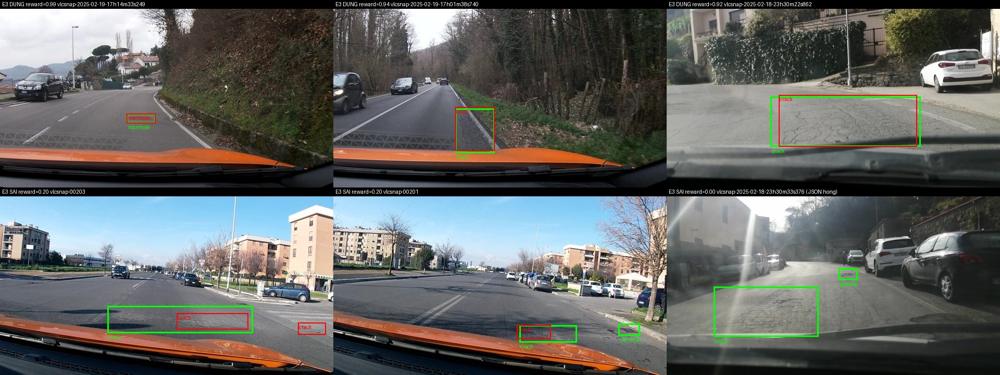

Họ tên: Tạ Quang Dũng
`dataset_version`: d10-21e4070301

## Bảng tổng hợp (số của bạn, lấy từ `report/evidence/*.json`)

| Mã | Setup | Tham số huấn luyện | VRAM đỉnh (GB) | Phút | F1 | CI95 | FP/ảnh | F1 pothole | F1 crack | F1 manhole |
|---|---|---|---|---|---|---|---|---|---|---|
| E0 | zero-shot | 0 | – | – | 0.086 | 0.061–0.113 | 0.92 | 0.107 | 0.032 | 0.178 |
| E1 | LoRA LLM | 33.030.144 | 6.82 | 41.7 | 0.262 | 0.227–0.301 | 1.32 | 0.184 | 0.190 | 0.518 |
| E2 | + projector | 142.135.296 | 8.64 | 42.6 | 0.314 | 0.277–0.352 | 1.18 | 0.179 | 0.259 | 0.558 |
| E3 | + LoRA ViT | 148.426.752 | 8.83 | 47.2 | 0.432 | 0.391–0.475 | 0.92 | 0.351 | 0.346 | 0.681 |
| E4 | data_size = 0.1 (142 ảnh, setup E3) | 148.426.752 | 12.0 | 51.5 | 0.298 | 0.263–0.335 | 1.61 | 0.193 | 0.213 | 0.624 |
| E4 | data_size = 1.0 (= E3) | 148.426.752 | 8.83 | 47.2 | 0.432 | 0.391–0.475 | 0.92 | 0.351 | 0.346 | 0.681 |

Mọi lần chạy trên Colab T4 16 GB, QLoRA NF4 cho LLM, ViT + projector + `lm_head` giữ fp16, 300 bước × batch 2 × tích luỹ 4, lr 2e-4, warmup 5% + cosine. Thời gian là thời gian train thật (không gồm suy luận ≈ 17–18 phút cho 311 ảnh).

Ảnh minh hoạ:

- `report/figures/step1_train_samples.jpg`: 6 ảnh train vẽ nhãn gốc (đỏ = pothole, vàng = crack, xanh = manhole), dùng để xác nhận đã hiểu đúng nhãn YOLO.
- `report/figures/predictions_best_worst.jpg`: 3 ảnh dự đoán tốt nhất và 3 ảnh tệ nhất của E3 trên test (xanh lá = GT, đỏ = dự đoán, xếp theo reward IoU của `rl/reward.py`).



Chú thích từng ảnh (trái → phải):
1. Trên-1, reward 0.99: manhole khớp gần như tuyệt đối (`[381,606,467,656]` vs dự đoán `[381,606,466,656]`).
2. Trên-2, reward 0.94: crack dọc mép đường, lệch < 1.2% chiều cao khung.
3. Trên-3, reward 0.92: mảng nứt lớn, dự đoán hẹp hơn GT ở mép trái (x1 = 336 vs 312).
4. Dưới-1, reward 0.20: GT là một vùng crack rộng `[322,631,759,775]`, model chia thành hai box nhỏ hơn → không box nào đạt IoU ≥ 0.5, thêm một box thừa ở phải.
5. Dưới-2, reward 0.20: bỏ sót manhole nhỏ ở mép phải, box crack chỉ phủ nửa trái vùng GT.
6. Dưới-3, reward 0.00: ảnh ngược sáng; model sinh hàng loạt box (crack, pothole lặp lại) tới khi bị cắt 256 token → JSON hỏng. Đây là output hỏng duy nhất của E3 (`parse_valid_rate` = 0.997).

## 10 câu hỏi (trả lời bằng **số của bạn**, không chép lại tài liệu)

### Câu 1 — Kiến trúc: ViT, projector và LLM của Qwen3-VL-4B có bao nhiêu tham số mỗi khối, và E1/E2/E3 mỗi cái cập nhật khối nào?

Đếm bằng `named_parameters()` trên model khởi tạo ở meta device:

| Khối | Tham số |
|---|---|
| ViT (patch embed + 24 block) | 306.242.560 |
| Projector: `visual.merger` | 27.271.680 |
| Projector: `visual.deepstack_merger_list` (3 merger cho lớp 5, 11, 17) | 81.833.472 |
| → Toàn bộ `visual` | 415.347.712 |
| LLM (36 lớp + embedding, embedding dùng chung với `lm_head`) | 4.022.468.096 |
| Tổng (không đếm trùng `lm_head`) | ≈ 4,44 tỉ |

- **E1**: chỉ LoRA r=16 trên 252 module của LLM (36 lớp × q/k/v/o/gate/up/down) → 33.030.144 tham số. ViT và projector đóng băng.
- **E2**: E1 + mở đầy đủ projector ở fp32 → 142.135.296, chênh đúng 109.105.152 = 27.271.680 + 81.833.472.
- **E3**: E2 + LoRA trên 96 module ViT (24 block × qkv/proj/linear_fc1/linear_fc2) → 348 module, 148.426.752 tham số (+6.291.456 so với E2).

Lưu ý khi viết `target_modules`: nếu liệt kê theo đuôi tên (`"linear_fc1"`, `"linear_fc2"`) như code mẫu thì LoRA sẽ khớp cả `visual.merger` và `deepstack_merger_list` (28 module mỗi tên thay vì 24) và bỏ sót `attn.proj`. Tôi dùng regex đầy đủ đường dẫn và kiểm tra `len(matched)` = 252 / 348, không có LoRA nào trong projector.

### Câu 2 — E0: `parse_valid_rate` bằng bao nhiêu, và hai lỗi phổ biến nhất của model gốc là gì (kèm một ví dụ output thô)?

`parse_valid_rate` = **0.836** (51/311 output hỏng); F1 = 0.086, P = 0.120, R = 0.067 (39 TP, 286 FP, 544 FN). Model không bao giờ bọc ```json (0/311), nhưng trả `[]` ở 17 ảnh dù ảnh nào trong test cũng có hư hại.

1. **Lặp box vô hạn đến khi bị cắt** → JSON không đóng. Model sinh một lưới box crack cách đều nhau, ví dụ ảnh `vlcsnap-2025-02-18-23h07m47s847`:
   `[{"label": "crack", "bbox_2d": [350, 370, 400, 400]}, {"label": "crack", "bbox_2d": [350, 330, 400, 360]}, {"label": "crack", "bbox_2d": [350, 290, 400, 320]}, … ` (giảm y đều 40 đơn vị, hết 256 token vẫn chưa đóng `]`).
2. **Bịa box / sai lớp, đặc biệt với crack**: F1 crack chỉ 0.032 (P = 0.040), so với manhole 0.178. Model gốc thấy "hư hại" nhưng không phân biệt được vết nứt với mặt đường, nên FP/ảnh = 0.92 trong khi recall chỉ 6.7%.

Ngoài ra có lỗi cú pháp nhỏ như `[287, 478, 357, 500)}]` (dùng `)` thay `]`). Sau SFT, `parse_valid_rate` lên 0.997 (E1), 1.000 (E2), 0.997 (E3).

### Câu 3 — Thang 0–1000: nếu chấm output theo pixel (hoặc ngược lại) thì F1 ra sao và vì sao? Bạn đã kiểm chứng điều này thế nào?

Kiểm chứng bằng chính đáp án đúng của 311 ảnh test (không cần GPU):

| Dự đoán | Chấm với | F1 | parse_valid | FP/ảnh |
|---|---|---|---|---|
| GT thang 0–1000 | `--coord norm1000` | 1.000 | 1.000 | 0.00 |
| GT thang pixel | `--coord pixel` | 1.000 | 1.000 | 0.00 |
| GT thang 0–1000 | `--coord pixel` | **0.000** | 1.000 | 1.87 |
| GT thang pixel | `--coord norm1000` | **0.000** | 1.000 | 1.87 |

Dù đáp án hoàn hảo và JSON hợp lệ 100%, chỉ cần lệch thang là F1 về 0 và mọi box (583 box, 1.87/ảnh) thành FP. Lý do: ảnh 640×360 nên hai thang khác nhau theo hệ số 0.64 trên trục x và 0.36 trên trục y. Một box ở `[400,500,600,700]` (0–1000) nếu hiểu là pixel sẽ bị kéo về `[625,1389,…]`, nằm ngoài khung hoặc dịch xa → IoU = 0 < 0.5. Vì hai trục co khác nhau, box còn bị méo chứ không chỉ dịch. Đây là triệu chứng "F1 ≈ 0 mà JSON hợp lệ" trong bảng sự cố.

Qwen3-VL dùng thang 0–1000 vì nó độc lập với độ phân giải: model thấy ảnh đã resize (ở đây 640×360 → lưới 22×40 patch 16 px sau khi gộp), nên toạ độ tương đối là thứ model học được nhất quán giữa các ảnh kích thước khác nhau. Tôi cũng kiểm tra chiều ngược lại: quy đổi YOLO → 0–1000 → pixel trên 3.515 box train cho sai số lớn nhất 0.32 px.

### Câu 4 — Mask loss: vì sao chỉ tính loss trên phần trả lời? Điều gì xảy ra nếu tính trên cả prompt và token ảnh?

Một ví dụ train (ảnh `20250216_164325`, 9 box) dài 562 token: 220 token `<|image_pad|>` (grid 1×22×40 → 880 patch, gộp 2×2), khoảng 90 token prompt/chat template, và 250 token đáp án + `<|im_end|>`. Ảnh điển hình chỉ có ~57 token đáp án (trung vị train), tức chỉ ~15% chuỗi. Tôi kiểm tra bằng cách giải mã các token có `labels != -100` và nhận đúng chuỗi JSON đáp án + `<|im_end|>`.

Chỉ tính loss trên đáp án vì đó là thứ duy nhất ta muốn model sinh ra. Nếu tính cả phần còn lại:
- **Prompt** giống hệt nhau ở mọi mẫu, model học thuộc nhanh và loss phần này về gần 0, nhưng nó vẫn chiếm phần lớn số token nên loss trung bình trông thấp giả, che mất tín hiệu từ phần JSON.
- **Token ảnh** là placeholder `<|image_pad|>` được thay bằng embedding thị giác; bắt LLM "dự đoán" chúng là mục tiêu vô nghĩa và đẩy gradient đi sai hướng.
- Kết quả: gradient bị pha loãng (~85% token không liên quan), model hội tụ chậm hơn ở phần toạ độ. Mask -100 cũng phải bao gồm `<|im_start|>assistant\n` để model không bị phạt vì phần template.

### Câu 5 — Vì sao không thể huấn luyện đầy đủ projector nếu ViT bị lượng tử hoá 4-bit, và bạn đã xử lý thế nào? Vì sao projector phải ở float32?

Tôi gặp đúng lỗi này. Với transformers 5.19, `llm_int8_skip_modules=["visual", "lm_head"]` (như GUIDE) **không** giữ được ViT: thư viện khớp tên bằng `re.match` từ đầu chuỗi, mà tên thật là `model.visual.…`, nên toàn bộ ViT và projector bị lượng tử hoá (chỉ `lm_head` khớp nhờ luật `endswith`). Hậu quả đo được:
- E2 chỉ mở được **87.609.344** tham số thay vì 142.135.296: phần projector đếm ra 54,5M = một nửa 109,1M, vì trọng số NF4 được đóng gói 2 giá trị/byte (`Params4bit` dạng uint8).
- Huấn luyện báo `Attempting to unscale FP16 gradients`: trọng số 4-bit là hằng số lượng tử + bảng scale, không phải tensor số thực liên tục, nên không có gradient đúng nghĩa để AdamW cập nhật; muốn "mở" phải dequantize, nhưng lúc lưu lại sẽ bị lượng tử hoá lần nữa và mất cập nhật nhỏ.

Cách xử lý: đổi thành `["model.visual", "lm_head"]`, thêm `assert` sau khi nạp model rằng không còn `Linear4bit` nào trong `visual`, rồi chạy lại E0/E1 với cấu hình đúng. VRAM sau khi nạp tăng từ 2.91 GB lên 3.51 GB (ViT fp16).

Projector phải ở fp32 vì nó được cập nhật **đầy đủ** với lr 2e-4: bước cập nhật lr × grad rất nhỏ so với độ lớn trọng số, fp16 (chỉ ~3 chữ số có nghĩa) sẽ làm tròn mất cập nhật; GradScaler cũng yêu cầu tham số cần unscale phải là fp32. LoRA cũng vậy: tôi phải ép mọi tham số `requires_grad` về fp32 vì peft tạo LoRA fp16 trên model 4-bit, gây đúng lỗi unscale FP16 ở bước đầu tiên của E1.

### Câu 6 — Split theo phiên quay: vì sao chia ngẫu nhiên sẽ cho F1 cao giả? Số ảnh và số box từng lớp ở mỗi split là bao nhiêu?

| Split | Ảnh | Box | pothole | crack | manhole | Session |
|---|---|---|---|---|---|---|
| train | 1.422 | 3.515 | 1.074 | 1.750 | 691 | 13 |
| val | 276 | 639 | 66 | 470 | 103 | 2 |
| test | 311 | 583 | 121 | 299 | 163 | 3 |

Không session nào xuất hiện ở hai split (đã `assert`). Ảnh là các frame cắt từ video dashcam cách nhau chưa tới 1 giây, nên hai frame liền kề gần như trùng: cùng ổ gà, cùng góc nhìn, cùng ánh sáng. Nếu chia ngẫu nhiên, gần như mọi ảnh test đều có "anh em sinh đôi" trong train, model chỉ cần nhớ box của frame bên cạnh là đạt F1 cao, nhưng đó là đo khả năng ghi nhớ chứ không phải tổng quát hoá sang con đường mới.

Chia theo session cũng làm phân bố lớp lệch: pothole chiếm 31% box train (1.074/3.515) nhưng chỉ 10% box val (66/639) và 21% box test. Vì vậy phải đọc F1 từng lớp, không chỉ F1 tổng.

### Câu 7 — So sánh E1/E2/E3: mở projector và LoRA trên ViT có đáng không (F1, CI95, VRAM, thời gian)?

| | F1 | CI95 | P / R | FP/ảnh | VRAM | Phút | Tham số |
|---|---|---|---|---|---|---|---|
| E1 | 0.262 | 0.227–0.301 | 0.267 / 0.257 | 1.32 | 6.82 | 41.7 | 33,0M |
| E2 | 0.314 | 0.277–0.352 | 0.325 / 0.304 | 1.18 | 8.64 | 42.6 | 142,1M |
| E3 | 0.432 | 0.391–0.475 | 0.456 / 0.410 | 0.92 | 8.83 | 47.2 | 148,4M |

- **Mở projector (E1 → E2)**: +0.052 F1, tốn thêm 1.8 GB VRAM (109M tham số fp32 cộng hai trạng thái AdamW ≈ 1.3 GB) nhưng gần như không thêm thời gian. Cải thiện chủ yếu ở crack (0.190 → 0.259). Tuy nhiên CI95 hai bên **giao nhau** (0.277 < 0.301), nên chưa đủ bằng chứng rằng E2 tốt hơn E1.
- **LoRA trên ViT (E2 → E3)**: +0.118 F1, chỉ thêm 6,3M tham số, +0.19 GB VRAM và +4.6 phút (+11%). CI95 **tách rời** (0.391 > 0.352), nên đây là cải thiện thật. Cả ba lớp đều tăng, rõ nhất pothole (0.179 → 0.351) và crack (0.259 → 0.346), đúng với lớp có box nhỏ nhất, nơi đặc trưng thị giác gốc của ViT (huấn luyện cho ảnh tổng quát) là nút thắt chứ không phải phần ngôn ngữ.
- **Đáng đồng tiền nhất: E3.** Chi phí gần như bằng E2 nhưng F1 tăng 0.17 so với E1. VRAM của E3 cao nhất vì gradient phải lan ngược qua cả 24 block ViT (thêm activation lưu cho backward) và projector fp32.

### Câu 8 — Tập test có 311 ảnh: khoảng tin cậy rộng thế nào, và điều đó giới hạn kết luận so sánh các setup ra sao?

CI95 bootstrap (1.000 lần lấy mẫu lại theo ảnh) rộng khoảng **0.07–0.08** điểm F1: E1 0.074, E2 0.075, E3 0.084, E4-0.1 0.072, tức khoảng ±0.04 quanh giá trị điểm. Lý do: chỉ 311 ảnh / 583 box, lại đến từ đúng 3 session, nên vài ảnh khó (ngược sáng, nứt rộng) đủ kéo F1 lên xuống.

Hệ quả cho kết luận:
- Chỉ những chênh lệch lớn hơn ~0.08 mới chắc chắn: E0 → E1 (+0.176), E2 → E3 (+0.118), E4 0.1 → 1.0 (+0.134) đều có CI tách rời.
- E1 → E2 (+0.052) **không** kết luận được: CI giao nhau.
- Ở cấp từng lớp còn yếu hơn: pothole test chỉ có 121 box, nên F1 pothole 0.184 (E1) vs 0.179 (E2) là khác biệt nhiễu.
- Test chỉ có 3 session, nên CI chỉ phản ánh nhiễu lấy mẫu ảnh, chưa phản ánh độ biến thiên giữa các con đường. Một session mới (đường khác, ánh sáng khác) có thể cho kết quả lệch ngoài cả CI này.
- Mỗi setup chỉ chạy 1 seed, nên phương sai do huấn luyện không nằm trong CI.

### Câu 9 — Phân tích lỗi theo lớp: lớp nào kém nhất và vì sao (kích thước box, số mẫu, ngữ nghĩa)? Kèm ảnh minh hoạ.

Với E3: manhole 0.681 ≫ pothole 0.351 ≈ crack 0.346.

| Lớp | Diện tích box trung vị (% khung, toàn dataset) | Box train | F1 E3 |
|---|---|---|---|
| pothole | 0.38% | 1.074 | 0.351 |
| crack | 1.42% | 1.750 | 0.346 |
| manhole | 0.46% | 691 | 0.681 |

- **Manhole tốt nhất dù ít mẫu nhất** vì ngữ nghĩa rõ: hình tròn/chữ nhật, viền kim loại, ranh giới sắc nét nên box GT nhất quán. Ví dụ ảnh trên-1: lệch 1 đơn vị trên thang 1000.
- **Pothole kém** chủ yếu do **kích thước**: box trung vị 0.38% khung, tức khoảng 30×30 px trên ảnh 640×360, chỉ chiếm vài patch 16 px sau khi ViT gộp 2×2. Sai lệch vài chục pixel đã làm IoU < 0.5. Đây cũng là lớp được lợi nhiều nhất khi mở LoRA ViT (0.179 → 0.351).
- **Crack kém** chủ yếu do **ngữ nghĩa mơ hồ của nhãn**: vết nứt không có biên rõ, người gán nhãn lúc khoanh cả mảng, lúc chia nhiều box nhỏ. Ảnh dưới-1 cho thấy model chia một vùng crack rộng thành hai box (mỗi box IoU < 0.5 với GT) dù vị trí đúng. Đây là lỗi "đúng chỗ nhưng sai cách cắt box" mà thước đo IoU ≥ 0.5 phạt nặng.
- Ảnh dưới-3 (ngược sáng) là trường hợp model lặp box tới khi bị cắt: JSON hỏng.

### Câu 10 — E4: bạn đổi biến nào, kết quả thế nào, và kết luận có đáng tin không?

Biến: **`data_size`**, giữ nguyên mọi thứ khác của setup tốt nhất E3 (r=16, 300 bước, lr 2e-4, seed 42). Giá trị 1.0 chính là E3 (chấm lại từ cùng dự đoán); giá trị 0.1 là 142 ảnh train lấy ngẫu nhiên cố định (`random.Random(42)`).

| data_size | Ảnh train | F1 | CI95 | P / R | FP/ảnh | pothole / crack / manhole |
|---|---|---|---|---|---|---|
| 0.1 | 142 | 0.298 | 0.263–0.335 | 0.275 / 0.326 | 1.61 | 0.193 / 0.213 / 0.624 |
| 1.0 | 1.422 | 0.432 | 0.391–0.475 | 0.456 / 0.410 | 0.92 | 0.351 / 0.346 / 0.681 |

- Chênh **+0.134 F1**, CI95 **tách rời** (0.391 > 0.335), nên kết luận "nhiều dữ liệu hơn tốt hơn rõ rệt" là đáng tin trong phạm vi tập test này.
- Với 10% dữ liệu, 300 bước × 8 ảnh = 2.400 lượt ảnh tương đương ~17 epoch trên 142 ảnh, nên model **quá khớp**: precision rơi mạnh (0.456 → 0.275) và FP/ảnh gần gấp đôi (0.92 → 1.61), trong khi recall giảm ít hơn (0.410 → 0.326). Model học "sinh nhiều box" nhưng không học được box nào là đúng.
- Manhole gần như không bị ảnh hưởng (0.681 → 0.624) vì là lớp dễ; pothole và crack giảm mạnh, đúng hai lớp khó ở Câu 9.
- Giới hạn: chỉ 1 seed cho tập con 10%, và một tập con khác có thể cho kết quả khác. Với hai giá trị, tôi chưa biết đường cong theo dữ liệu bão hoà ở đâu. VRAM đỉnh của run 0.1 là 12.0 GB so với 8.83 GB ở E3 dù cùng setup; tôi đoán là do tập con chứa vài ảnh có đáp án rất dài (chuỗi dài hơn → activation lớn hơn), nhưng chưa kiểm chứng.

## Nhìn lại

- **Lỗi công cụ chấm không bắt được:** `llm_int8_skip_modules=["visual", …]` âm thầm lượng tử hoá cả ViT với transformers 5.x. Lần chạy E1 đầu tiên với cấu hình sai vẫn cho F1 0.261 (CI 0.223–0.301), gần như bằng E1 đúng (0.262), nên nhìn kết quả không thể phát hiện. Tôi chỉ thấy khi E2 mở được 54,5M thay vì 109M tham số projector. `score.py` không biết model được nạp thế nào. Bài học: luôn `assert` số tham số huấn luyện và kiểu module sau khi nạp.
- Peft trên Colab ném `ImportError` vì torchao 0.10 có sẵn trên Colab (cần ≥ 0.16), chỉ khi gắn LoRA vào `nn.Linear` thường (ViT ở E3); các lớp 4-bit của LLM được bnb nhận trước nên E1/E2 không gặp.
- `max_new_tokens=256` đủ cho test (đáp án dài nhất 196 token) nhưng model vẫn có lúc lặp box tới khi bị cắt (ảnh dưới-3). Thêm `repetition_penalty` hoặc dừng sớm khi đóng `]` có thể giảm lỗi này.
- Điều tôi chưa hiểu rõ: vì sao VRAM của run E4 0.1 cao hơn E3 dù cùng cấu hình; và liệu LoRA ViT có còn thắng projector khi train lâu hơn hay chỉ hội tụ nhanh hơn.
- E5 (GRPO) đã viết và test hàm reward (`rl/`, 11 test) nhưng chưa chạy vì hết hạn mức GPU Colab.
